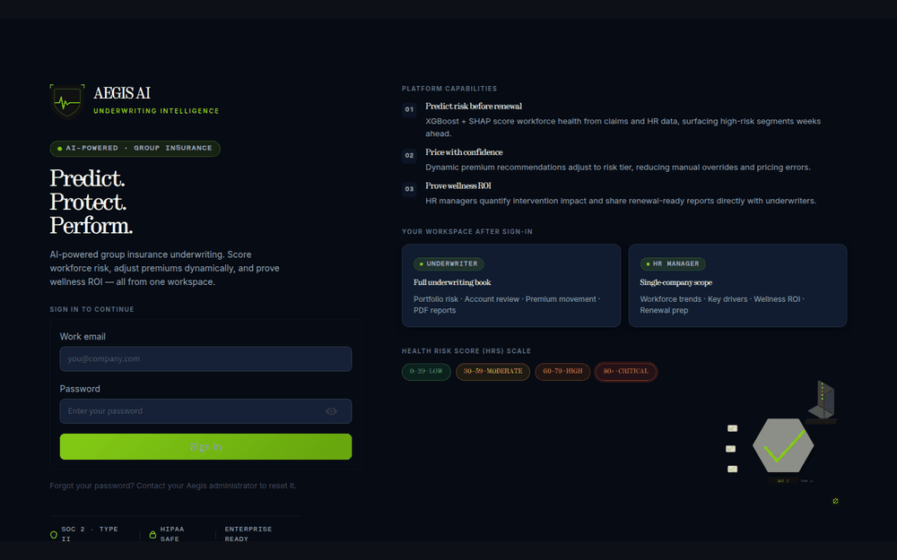
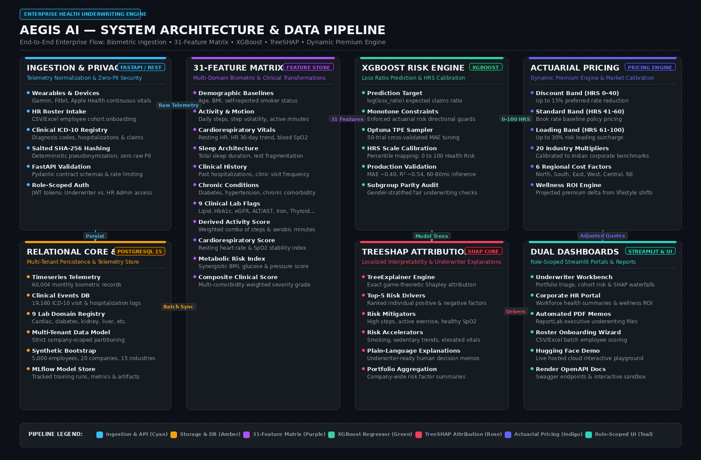
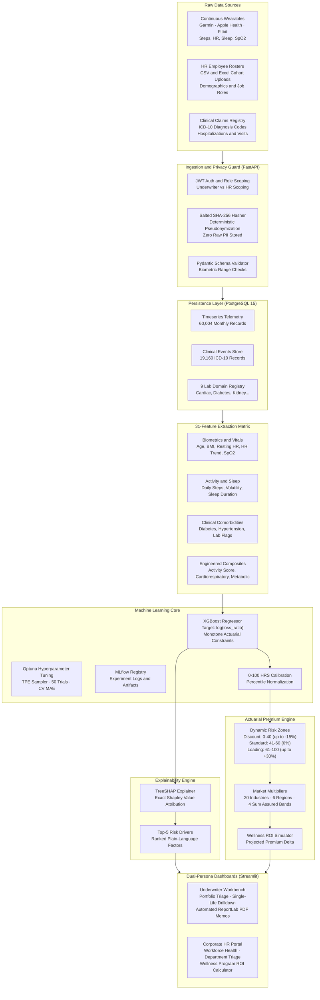
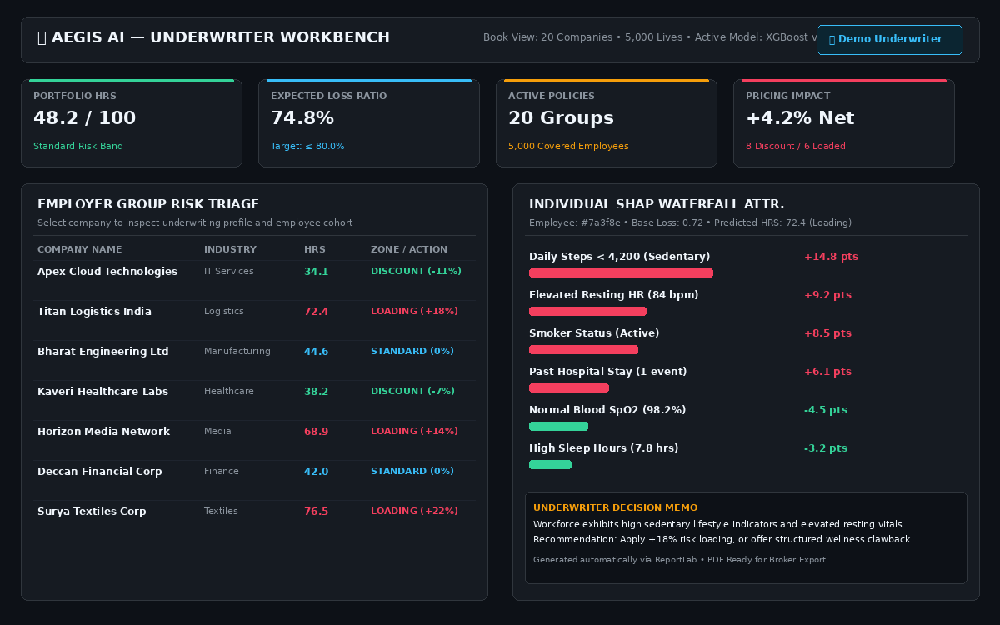
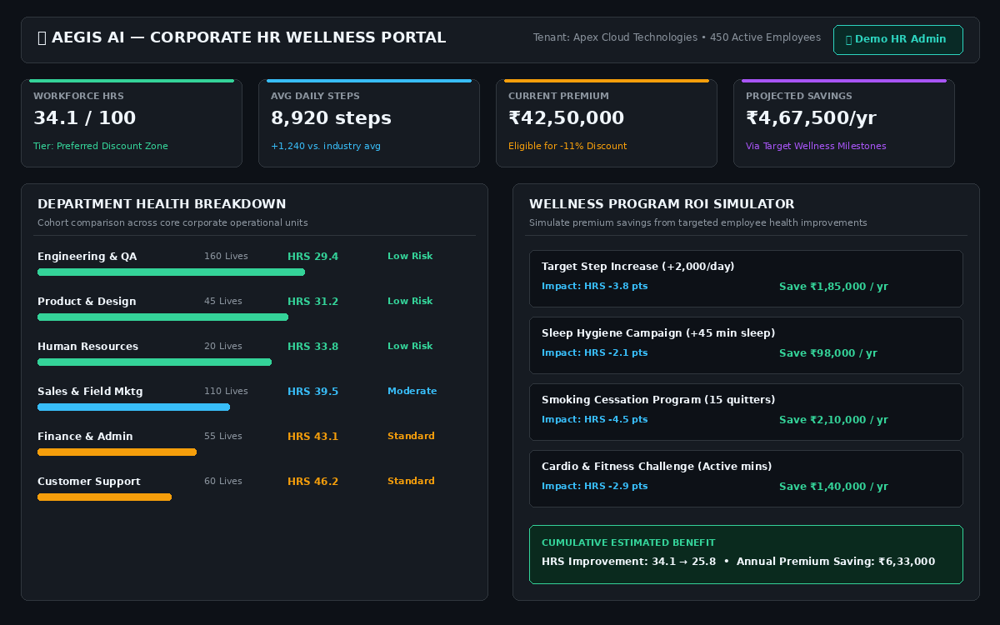
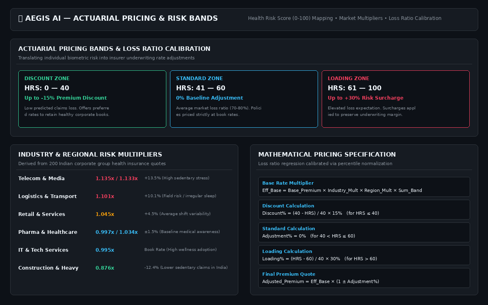

<div align="center">

# 🛡️ Aegis AI

### Enterprise Health-Risk Underwriting & Dynamic Pricing Platform

**Transforming group health insurance from reactive trailing-claims pricing to proactive, continuous biometric risk scoring with game-theoretic TreeSHAP explainability and actuarial premium adjustments.**

<br />

[](https://github.com/rupal2k/aegis-ai/actions/workflows/ci.yml)
[](https://aegis-ai-wss8.onrender.com/docs)
[](https://www.python.org/)
[](MODEL_CARD.md)
[](#treeshap-explainability-and-risk-attribution)
[](#architecture)
[](#getting-started)
[](https://huggingface.co/spaces/Rupa2k/aegis-ai)
[](LICENSE)

<br />

[Overview](#overview) • [Core Capabilities](#core-capabilities) • [Architecture](#system-architecture) • [Visual Showcase](#dual-persona-visual-showcase) • [31-Feature Matrix](#31-feature-biometric--clinical-matrix) • [Subsystems](#subsystems) • [API Matrix](#api-endpoint-reference) • [Getting Started](#getting-started)

<br />

| 🌐 **Live Interactive Space** | ⚡ **Live Interactive API** | 📋 **Model Card** | 📊 **Training Telemetry** |
|:---:|:---:|:---:|:---:|
| [huggingface.co/spaces/Rupa2k/aegis-ai](https://huggingface.co/spaces/Rupa2k/aegis-ai) | [aegis-ai-wss8.onrender.com/docs](https://aegis-ai-wss8.onrender.com/docs) | [MODEL_CARD.md](MODEL_CARD.md) | [TRAINING_RESULTS.md](TRAINING_RESULTS.md) |

<br />



</div>

<br />

> ℹ️ *The live demo is hosted on free-tier infrastructure. If waking from idle, please allow ~45–60 seconds for the container stack to spin up.*

---

## Overview

Traditional group health insurance underwriting is fundamentally reactive. Policies are priced almost exclusively off an employer's trailing claims history from the previous year. This legacy model suffers from three critical flaws:
1. **Backward-Looking Lag**: Claims data reflects past catastrophic hospitalizations rather than current workforce health trajectory.
2. **Zero Wellness Incentive**: Employers investing in corporate preventative care, gym memberships, or wellness programs receive zero premium adjustments because benefits take years to reflect in trailing claims.
3. **Black-Box Underwriting**: Underwriters lack granular visibility into what lifestyle, biometric, and chronic factors drive workforce risk.

**Aegis AI** solves this with continuous, privacy-first risk scoring. By ingesting anonymized wearable biometric telemetry (daily steps, resting heart rate, sleep architecture, blood oxygen) alongside clinical ICD-10 history, Aegis AI produces a calibrated **Health Risk Score (HRS, 0–100)** per employee and employer group.

Every prediction is paired with localized **game-theoretic TreeSHAP attribution** (surfacing the top-5 plain-language risk drivers) and translated into dynamic actuarial premium adjustments across Discount, Standard, and Loading bands.

### Core Design Principles

- **Zero-PII Pseudonymization**: All incoming employee identifiers are salted and SHA-256 hashed prior to persistence. Raw names, emails, and identifiers are never stored.
- **Actuarial Monotone Constraints**: The underlying XGBoost regressor enforces strict directional constraints: age, smoking, and BMI can never decrease risk; aerobic activity, steps, and healthy SpO2 can never increase risk.
- **Explainability by Design**: No black-box predictions. Underwriters receive ranked, plain-language SHAP contribution waterfalls for every quote.
- **Strict Role-Scoped Authorization**: Underwriters inspect the complete portfolio book; corporate HR administrators are strictly scoped to their own workforce tenant at the API layer.
- **Reproducible ML Lifecycle**: Automated Optuna hyperparameter search with 5-fold cross-validation, tracked end-to-end in MLflow.

---

## Core Capabilities

| Capability | Technical Implementation | Underwriting Value |
|---|---|---|
| **Health Risk Score (HRS)** | XGBoost regressor predicting $\log(\text{loss\_ratio})$, calibrated to 0–100 | Replaces stale trailing claims with real-time biometric risk triage across individual and corporate cohorts. |
| **TreeSHAP Explainability** | Exact game-theoretic Shapley value decomposition | Generates top-5 plain-language positive and negative risk contributors for transparent underwriting decisions. |
| **Dynamic Premium Engine** | Multi-band actuarial mapping (Discount 0–40, Standard 41–60, Loading 61–100) | Rewards healthy corporate cohorts with up to 15% discounts while protecting loss margins with up to +30% loading. |
| **Market Multipliers** | Calibrated against 20 Indian industries, 6 geographic zones & 4 sum assured bands | Adjusts baseline rates for regional cost-of-care factors and industry-specific sedentary or stress risks. |
| **Wellness ROI Simulator** | Actuarial sensitivity projection model | Demonstrates tangible premium savings resulting from targeted workforce health interventions (e.g. +2,000 steps/day). |
| **Role-Scoped Dashboards** | Dual Streamlit interfaces with JWT token role enforcement | Underwriter Workbench for book management; Corporate HR Portal for department wellness tracking and PDF exports. |
| **Subgroup Parity & Fairness** | Automated gender-stratified audit script (`fairness_check.py`) | Prevents algorithmic bias across protected attributes and ensures equitable premium band distribution. |

---

## System Architecture

### End-to-End Enterprise Data Pipeline

<div align="center">
  <a href="docs/images/architecture-diagram.png" target="_blank" title="Click to open full-resolution schematic">
    
  </a>
  <p align="center">
    <a href="docs/images/architecture-diagram.png" target="_blank">🔍 <b>Open Full-Resolution Schematic (1600 × 1050 px)</b></a> &nbsp;•&nbsp;
    <a href="#interactive-flowchart">📊 <b>Jump to Interactive Flowchart</b></a>
  </p>
</div>

<div id="interactive-flowchart"></div>

<details>
<summary><b>View Interactive Architecture Flowchart (Mermaid)</b></summary>
<br />



</details>

### Production Technology Stack

| Layer | Technologies | Role in Platform |
|---|---|---|
| **Ingestion & Serving** | FastAPI, Pydantic v2, SQLAlchemy 2.0, PostgreSQL 15 | Validates biometric ingestion, hashes PII, enforces role-scoped JWT authorization. |
| **Machine Learning Core** | XGBoost 2.0, Optuna, scikit-learn, MLflow | Fits histogram gradient boosted trees with monotone constraints and tracks training artifacts. |
| **Explainable AI (XAI)** | TreeSHAP (SHAP library) | Decomposes individual tree paths into exact Shapley localized feature attributions. |
| **Actuarial Calculations** | NumPy, SciPy | Normalizes loss ratio predictions and computes regional/industry market multipliers. |
| **UI & Visualizations** | Streamlit, Plotly Express, ReportLab | Interactive Underwriter Workbench, Corporate HR Portal, and automated PDF export memos. |
| **Deployment & Ops** | Docker Compose, Nginx (TLS proxy), GitHub Actions, Render, Hugging Face | Multi-container stack with automated CI security scanning (`bandit`, `pip-audit`). |

---

## Dual-Persona Visual Showcase

The platform features two purpose-built interfaces tailored to their respective roles:

### 💼 Persona 1: Underwriter Workbench

Built for senior underwriters, actuaries, and pricing analysts to manage multi-group portfolios, triage high-risk employers, and inspect individual claims risk.

<div align="center">
  <a href="docs/images/underwriter-workbench.png" target="_blank" title="Click to view full-resolution Underwriter Workbench">
    
  </a>
  <p align="center"><sub>🔍 <b>Click to expand Underwriter Workbench view (1200 × 750 px)</b></sub></p>
</div>

- **Portfolio Risk Triage**: Real-time distribution of all active employer policies across Discount, Standard, and Loading bands.
- **Employer Group Explorer**: Drill down into any corporate account to evaluate expected loss ratio, active employee headcount, and aggregate HRS.
- **Single-Life SHAP Waterfall**: Unpacks exact localized risk attributions for any employee. Identifies whether elevated risk stems from sedentary vitals, chronic comorbidity, or past hospitalization.
- **Automated Underwriting Memos**: Generates executive PDF reports via ReportLab ready for broker negotiations and governance review.

---

### 🏢 Persona 2: Corporate HR Wellness Portal

Designed for Chief Human Resources Officers (CHROs), employee benefits managers, and corporate wellness coordinators to monitor workforce wellbeing without violating individual privacy.

<div align="center">
  <a href="docs/images/hr-wellness-portal.png" target="_blank" title="Click to view full-resolution Corporate HR Portal">
    
  </a>
  <p align="center"><sub>🔍 <b>Click to expand Corporate HR Portal view (1200 × 750 px)</b></sub></p>
</div>

- **Workforce Health Score (HRS)**: Aggregated company health metric calibrated against industry baselines.
- **Department Health Breakdown**: Identifies lifestyle differences across business units (e.g., Engineering vs. Sales) while preserving employee anonymity.
- **Wellness Program ROI Simulator**: Interactively models premium reductions achievable through corporate wellness interventions (e.g. step challenges, smoking cessation campaigns).

---

### 📊 Actuarial Risk Bands & Pricing Model

<div align="center">
  <a href="docs/images/actuarial-pricing-model.png" target="_blank" title="Click to view full-resolution Actuarial Pricing Model">
    
  </a>
  <p align="center"><sub>🔍 <b>Click to expand Pricing Engine & Calibration curve (1200 × 750 px)</b></sub></p>
</div>

The platform dynamically maps continuous Health Risk Scores (0–100) into three actuarial pricing zones:
1. **Discount Zone (HRS 0–40)**: Preferred rate for healthy, active workforces. Premium discounts scale linearly up to **15%**.
2. **Standard Zone (HRS 41–60)**: Baseline rate for average market risk cohorts (expected loss ratio 70–80%).
3. **Loading Zone (HRS 61–100)**: Surcharge zone for cohorts with elevated chronic or sedentary risks. Premium loadings scale linearly up to **+30%**.

Market multipliers further calibrate quotes against **20 Indian industries** (e.g., Telecom `1.135×`, Construction `0.876×`), **6 geographic regions** (Central, East, North, Northeast, South, West), and **4 Sum Assured bands** (1–3L, 4–7L, 8–15L, 15L+).

---

## 31-Feature Biometric & Clinical Matrix

The machine learning engine transforms 31 normalized features across 5 distinct clinical and biometric domains:

| Category | Feature Name | Type | Unit / Range | Actuarial Rationale & Constraint |
|---|---|:---:|:---:|---|
| **Demographics** | `age` | `int` | 21–65 yrs | Baseline mortality and morbidity risk curve (Monotone: **+**). |
| | `bmi` | `float` | 16.0–45.0 | Body Mass Index; indicator for metabolic comorbidity (Monotone: **+**). |
| | `smoker` | `binary` | 0 or 1 | Tobacco consumption flag; critical risk accelerator (Monotone: **+**). |
| **Wearable Vitals** | `avg_daily_steps` | `int` | 1,000–25,000 | Primary indicator of cardiovascular fitness (Monotone: **–**). |
| | `step_volatility` | `float` | 0.0–1.0 | Coefficient of variation in daily activity (inconsistent habit flag). |
| | `avg_resting_hr` | `float` | 45–110 bpm | Resting heart rate; proxy for autonomic tone and cardiac strain. |
| | `hr_trend` | `float` | -5.0 to +5.0 | 30-day slope of resting heart rate (rising trend indicates stress/illness). |
| | `avg_active_mins` | `int` | 0–180 min | Sustained aerobic/moderate physical activity duration (Monotone: **–**). |
| | `avg_sleep_hours` | `float` | 3.5–11.0 hrs | Sleep duration; non-linear U-shaped risk curve. |
| | `avg_spo2` | `float` | 88.0–100.0% | Mean nocturnal/daytime blood oxygen saturation (Monotone: **–**). |
| **Clinical Events** | `visit_count` | `int` | 0–24 visits | Outpatient clinical consultations within the rolling 12-month window. |
| | `hospitalized_count`| `int` | 0–5 stays | Inpatient admissions; heavy predictor of catastrophic loss (Monotone: **+**). |
| **Chronic Status**| `diabetic` | `binary` | 0 or 1 | Type-2 diabetes diagnosis indicator (ICD-10 `E11`). |
| | `hypertension` | `binary` | 0 or 1 | Essential hypertension diagnosis indicator (ICD-10 `I10`). |
| | `chronic_count` | `int` | 0–6 | Total diagnosed chronic comorbidities across ICD-10 registries. |
| **9 Lab Domains** | `lab_heart_flag` | `binary` | 0 or 1 | Elevated cardiac markers (Troponin, CK-MB, lipid anomalies). |
| | `lab_inflammation_flag` | `binary` | 0 or 1 | Elevated hs-CRP or ESR markers indicating active systemic inflammation. |
| | `lab_diabetes_flag`| `binary` | 0 or 1 | Uncontrolled HbA1c ($\ge 6.5\%$) or elevated fasting plasma glucose. |
| | `lab_kidney_flag` | `binary` | 0 or 1 | Sub-optimal eGFR ($< 60\,\text{mL/min}$) or elevated serum creatinine. |
| | `lab_liver_flag` | `binary` | 0 or 1 | Elevated liver enzymes (ALT / AST $> 3\times$ upper reference limit). |
| | `lab_iron_flag` | `binary` | 0 or 1 | Serum ferritin depletion or severe microcytic anemia. |
| | `lab_thyroid_flag` | `binary` | 0 or 1 | TSH dysregulation (hypothyroidism or hyperthyroidism). |
| | `lab_bone_flag` | `binary` | 0 or 1 | Severe calcium / alkaline phosphatase or bone density deficit. |
| | `lab_vitamin_flag` | `binary` | 0 or 1 | Severe Vitamin D3 ($< 10\,\text{ng/mL}$) or Vitamin B12 deficiency. |
| **Derived Indices**| `activity_score` | `float` | 0–100 | Composite index: $\frac{\text{steps}}{20000}\times 40 + \frac{\text{active\_mins}}{120}\times 30 + \dots$ |
| | `cardio_resp_score`| `float` | 0–100 | Synergistic score combining normalized resting HR and SpO2 levels. |
| | `metabolic_index` | `float` | 0–100 | Compound metabolic risk index (BMI $\times$ glucose $\times$ BP indicators). |
| | `sleep_quality` | `float` | 0–100 | Sleep duration normalized against optimal 7.0–8.5 hour restorative band. |
| | `clinical_risk_score`| `float`| 0–100 | Weighted summation of hospital stays, clinic visits, and active lab flags. |
| | `composite_risk` | `float` | 0–100 | Multi-domain interaction term combining biometric and clinical risk. |
| | `volatility_penalty`| `float`| 0–25 | Variance surcharge penalizing erratic, unpredictable physical activity. |

---

## Subsystems

### Telemetry Ingestion & Privacy Guard

<details open>
<summary><b>Click to expand architecture & operational details</b></summary>
<br />

The ingestion engine is powered by FastAPI and SQLAlchemy, engineered to receive batch timeseries data from wearable device aggregators, HR rosters, and hospital billing systems:

- **Salted SHA-256 Pseudonymization**: Incoming records containing employee identifiers (e.g. `EMP-40912`) are concatenated with a server-side secret cryptographic salt (`HASH_SALT`) and hashed before database storage. Reverse lookups are cryptographically infeasible.
- **Pydantic Validation**: Every payload undergoes schema enforcement with biometric range sanity checks (e.g. rejecting heart rates $>220$ bpm or sleep durations $>24$ hrs).
- **Least-Privilege API Scoping**: Inbound JWT tokens contain claim roles (`underwriter` or `hr_admin`). Endpoints enforcing `@require_role("underwriter")` reject HR administrators, preventing cross-tenant corporate leakage.

</details>

### XGBoost Regressor & Monotone Constraints

<details>
<summary><b>Click to expand architecture & operational details</b></summary>
<br />

The core prediction engine is an XGBoost regressor trained against $\log(\text{loss\_ratio})$ to accommodate right-skewed claims distributions:

- **Monotone Risk Enforcement**: Traditional unconstrained tree models can make counter-intuitive predictions in sparse feature regions (e.g. predicting lower risk for a 62-year-old smoker than a 60-year-old non-smoker). Aegis AI passes explicit `monotone_constraints` vectors into XGBoost, guaranteeing non-decreasing risk for age, BMI, and smoker flags, and non-increasing risk for daily steps, active minutes, and SpO2.
- **Optuna Hyperparameter Optimization**: Tree depth, learning rate, minimum child weight, subsample ratios, and L1/L2 regularization terms are tuned using Tree-structured Parzen Estimator (TPE) across 50 trials optimizing 5-fold cross-validated Mean Absolute Error (MAE).
- **Percentile Calibration**: Continuous predictions are mapped through empirical percentile ranks ($p_{05} = 0$, $p_{95} = 100$) to yield intuitive, consistent 0–100 Health Risk Scores.

</details>

### TreeSHAP Explainability and Risk Attribution

<details>
<summary><b>Click to expand architecture & operational details</b></summary>
<br />

Aegis AI incorporates `shap.TreeExplainer` directly into the prediction lifecycle to eliminate black-box decision making:

- **Exact Shapley Values**: Calculates the game-theoretic marginal contribution of each of the 31 features relative to the base expected value $E[f(x)]$.
- **Top-5 Risk Attribution**: For every single-employee and corporate prediction, the engine sorts and returns the top 5 localized risk drivers formatted into plain English (e.g., *Daily Steps < 4,200 (+14.8 pts)* or *Resting HR 62 bpm (–5.1 pts)*).
- **Audit Trails**: Explanations are cached in PostgreSQL alongside the score, ensuring regulatory compliance and auditability during dispute resolutions.

</details>

### Actuarial Premium Engine & Wellness ROI

<details>
<summary><b>Click to expand architecture & operational details</b></summary>
<br />

The premium calculator translates Health Risk Scores into dynamic rate adjustments:

$$\text{Effective Base} = \text{Base Premium} \times \text{Industry Multiplier} \times \text{Region Multiplier} \times \text{Sum Assured Band}$$

- **Discount Zone ($\text{HRS} \le 40$)**:
  $$\text{Discount \%} = \frac{40 - \text{HRS}}{40} \times 15\% \implies \text{Adjusted Premium} = \text{Effective Base} \times (1 - \text{Discount})$$
- **Standard Zone ($40 < \text{HRS} \le 60$)**:
  $$\text{Adjusted Premium} = \text{Effective Base}$$
- **Loading Zone ($\text{HRS} > 60$)**:
  $$\text{Loading \%} = \frac{\text{HRS} - 60}{40} \times 30\% \implies \text{Adjusted Premium} = \text{Effective Base} \times (1 + \text{Loading})$$

The **Wellness ROI Simulator** projects the financial impact of employee habit improvements: simulating an employer-wide step increase of $+2,000$ steps/day recalculates the 31-feature vector, updates the expected loss ratio, and presents the resulting annual premium reduction directly to the HR benefits team.

</details>

### Fairness Considerations & Subgroup Audit

<details>
<summary><b>Click to expand architecture & operational details</b></summary>
<br />

Algorithmic underwriting systems must never penalize protected demographic attributes:

- **Isolated Sensitive Features**: Biological sex and age are strictly controlled; race, religion, and socio-economic indicators are omitted from the feature matrix.
- **Fairness Audit (`fairness_check.py`)**: Runs gender-stratified evaluations across the synthetic test cohort to verify that Mean Absolute Error (MAE) and risk-band assignments demonstrate demographic parity without adverse impact.

</details>

---

## API Endpoint Reference

All endpoints except `/health` require a Bearer JWT token issued by `POST /auth/token`. Interactive documentation and schema definitions are live at [`/docs`](https://aegis-ai-wss8.onrender.com/docs).

| Method | Endpoint | Authorized Roles | Description |
|:---:|---|:---:|---|
| `POST` | `/auth/token` | Public | Authenticates credentials (`username`, `password`) and returns a scoped JWT bearer token. |
| `GET` | `/health` | Public | Service liveness and container uptime probe. |
| `GET` | `/health/db` | Public | Verifies PostgreSQL database connectivity and migration status. |
| `POST` | `/ingest/wearable` | `underwriter`, `hr_admin` | Ingests continuous telemetry records (steps, HR, sleep, SpO2). |
| `POST` | `/ingest/clinical` | `underwriter` | Registers an inpatient or outpatient ICD-10 clinical diagnosis event. |
| `POST` | `/ingest/company` | `underwriter`, `hr_admin` | Bulk-uploads employee rosters with automated salted SHA-256 pseudonymization. |
| `POST` | `/predict/employee` | `underwriter` | Computes individual employee 0–100 HRS and localized top-5 SHAP waterfall drivers. |
| `GET` | `/predict/company/{id}`| `underwriter`, `hr_admin` | Returns aggregated workforce HRS, risk distribution, and cohort health telemetry. |
| `POST` | `/predict/premium` | `underwriter` | Calculates actuarial premium quote with dynamic discount/loading and market multipliers. |
| `POST` | `/predict/wellness-roi` | `underwriter`, `hr_admin` | Simulates premium savings resulting from targeted workforce health interventions. |
| `GET` | `/companies` | `underwriter`, `hr_admin` | Lists employer groups accessible to the caller (scoped by role and tenant). |
| `GET` | `/companies/{id}/employees`| `underwriter`, `hr_admin` | Returns employee cohort for an authorized company (PII pseudonymized). |

---

## Getting Started

### Prerequisites

- **Docker & Docker Compose** (Recommended): Docker 24.0+ with at least 4 GB RAM allocated to containers.
- **Python** (for local development without Docker): Python 3.11 with PostgreSQL 15 installed.

---

### 1-Click Launch with Docker Compose

1. **Clone the repository**:
   ```bash
   git clone https://github.com/rupal2k/aegis-ai.git
   cd aegis-ai
   ```

2. **Configure environment variables**:
   ```bash
   cp .env.example .env
   # Edit .env to set your SECRET_KEY, HASH_SALT, and database credentials
   ```

3. **Define demo users**:
   Add user definitions to `config/users.json` (or set `AEGIS_USERS_JSON` in `.env`):
   ```json
   [
     {
       "email": "underwriter@example.com",
       "password_hash": "$2b$12$e8YdC0...",
       "role": "underwriter",
       "name": "Demo Underwriter",
       "org": "Example Insurance Corp"
     },
     {
       "email": "hr@example.com",
       "password_hash": "$2b$12$e8YdC0...",
       "role": "hr_admin",
       "name": "Demo HR Admin",
       "org": "Apex Cloud Technologies",
       "company_id": "company-apex-001"
     }
   ]
   ```
   *(Generate bcrypt password hashes using `python3 -c "import bcrypt; print(bcrypt.hashpw(b'password', bcrypt.gensalt()).decode())"`)*.

4. **Start the multi-container stack**:
   ```bash
   docker compose up -d
   ```

On first boot, the stack automatically:
- Initializes PostgreSQL schemas and migrations.
- Generates a synthetic dataset of **20 companies, 5,000 employees, 60,004 monthly telemetry rows, and 19,160 clinical events**.
- Executes the Optuna training pipeline, registers model artifacts in MLflow, and caches baseline predictions.

| Service | Endpoint URL | Default Credentials |
|---|---|---|
| **Streamlit Dashboard** | [http://localhost:8501](http://localhost:8501) | Defined in `config/users.json` |
| **FastAPI Swagger Docs**| [http://localhost:8000/docs](http://localhost:8000/docs) | Authenticate with `/auth/token` |
| **MLflow Registry** | [http://localhost:5000](http://localhost:5000) | Local admin |

---

### Local Development (Without Docker)

1. **Create and activate a virtual environment**:
   ```bash
   python3.11 -m venv .venv
   source .venv/bin/activate
   pip install -r requirements.docker.txt
   ```

2. **Seed database and train the model**:
   ```bash
   # Ensure local PostgreSQL is running with DATABASE_URL set
   python data/generate.py             # Generate synthetic cohort data
   python data/load_to_db.py           # Seed PostgreSQL tables
   python -m ml_engine.training.train  # Train XGBoost model and register artifacts
   ```

3. **Launch API and Dashboard**:
   ```bash
   # Terminal 1: Ingestion & Prediction API
   uvicorn ingestion.main:app --host 0.0.0.0 --port 8000 --reload --no-server-header

   # Terminal 2: Streamlit Dashboard
   streamlit run dashboard/app.py --server.port 8501
   ```

---

## Testing & Quality Assurance

Aegis AI includes an automated test suite covering API contracts, data normalization, ML feature engineering, and security policies:

```bash
# Run pytest test suite
python -m pytest tests/ -v
```

### Automated CI Workflow

Every push to `main` triggers the [GitHub Actions CI Pipeline](.github/workflows/ci.yml):
1. **Static Analysis & Security Audit**: Runs `bandit` across all Python source trees and executes `pip-audit` to detect CVE vulnerabilities.
2. **Integration Testing**: Spawns an ephemeral PostgreSQL service, generates test fixtures, fits a fast test model, and executes the complete test suite.
3. **Container Build Verification**: Builds multi-stage Docker images for the API, dashboard, and Nginx proxy to prevent deployment regressions.

---

## Project Structure

```
aegis-ai/
├── config/                 # User store definitions and local environment overrides
├── dashboard/              # Streamlit multi-persona web application
│   ├── app.py              # Main application router and session state manager
│   ├── auth.py             # JWT token exchange and role authentication helpers
│   ├── underwriter_view.py # Underwriter Workbench: portfolio triage and SHAP waterfalls
│   ├── hr_view.py          # Corporate HR Portal: department health and wellness ROI
│   ├── upload_view.py      # CSV/Excel employee roster onboarding wizard
│   ├── training_data_view.py # Dataset telemetry and MLflow metrics explorer
│   ├── pdf_report.py       # ReportLab automated PDF underwriting memo generator
│   └── design_tokens.py    # Custom corporate theme tokens and CSS design system
├── data/                   # Synthetic data generation and database bootstrap scripts
│   ├── generate.py         # Correlated biometric and clinical data synthesizer
│   └── load_to_db.py       # PostgreSQL batch insertion and schema loader
├── docs/                   # Documentation assets, specifications, and architecture diagrams
│   └── images/             # Publication-grade diagrams, UI mockups, and walkthrough GIF
├── ingestion/              # FastAPI microservice for data intake and scoring
│   ├── main.py             # Application entrypoint, CORS, and middleware
│   ├── auth/               # JWT token verification and role dependency guards
│   ├── models/             # Pydantic request and response contract schemas
│   └── routers/            # Endpoint handlers: /auth, /ingest, /predict, /companies
├── ml_engine/              # Core machine learning and actuarial scoring engines
│   ├── features.py         # 31-feature extraction and mathematical transformation rules
│   ├── scorer.py           # XGBoost inference pipeline and 0-100 HRS calibration
│   ├── explainer.py        # TreeSHAP localized Shapley value attribution engine
│   ├── premium_calculator.py # Dynamic premium adjustment formula and market multipliers
│   ├── training/           # Optuna tuning, cross-validation, and MLflow logging
│   └── artifacts/          # Serialized model weights and calibrated scaler binaries
├── nginx/                  # TLS reverse proxy configurations for Compose deployments
├── scripts/                # Container bootstrap and entrypoint lifecycle scripts
├── tests/                  # Pytest unit, integration, and security test suite
├── tools/                  # Developer utilities: diagram and showcase GIF generators
├── docker-compose.yml      # Multi-container local production environment
├── Dockerfile.api          # Production image for FastAPI backend (Render deployment)
├── Dockerfile              # Production image for Streamlit dashboard (Hugging Face Spaces)
└── render.yaml             # Render infrastructure blueprint specification
```

---

## Roadmap

- [ ] **Streaming Ingestion (Apache Kafka)**: Support continuous streaming telemetry from enterprise wearables.
- [ ] **Temporal Risk Forecasting (LSTM / Temporal Fusion Transformers)**: Multi-quarter risk trajectory forecasting to predict health depreciation before it occurs.
- [ ] **Automated Re-training & Drift Guard**: Integration with Evidently AI to monitor data drift and trigger re-training when population vitals shift.
- [ ] **Enterprise SSO Integration**: Support SAML 2.0 and OpenID Connect (OIDC) for Okta, Azure AD, and Google Workspace authentication.
- [ ] **Confidence Intervals on Quotes**: Conformal prediction bounds providing actuaries with 90% and 95% confidence intervals on expected loss ratios.

---

## License

This project is licensed under the **MIT License**. See the [LICENSE](LICENSE) file for complete details.

---

## Disclaimer

> ⚠️ **Research & Demonstration Notice**: Aegis AI is developed as an educational, architectural demonstration of explainable machine learning in insurance underwriting. It is trained on synthetic biometric data and has not been approved by regulatory bodies (e.g. IRDAI) for real-world underwriting of human lives. Loss ratio predictions are relative research signals, not actuarially certified insurance policies.
